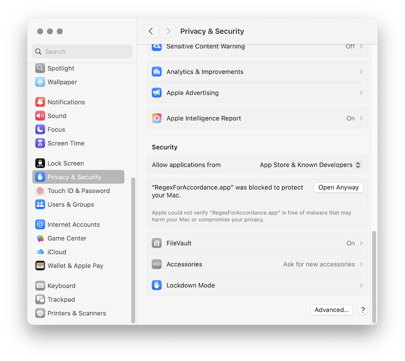
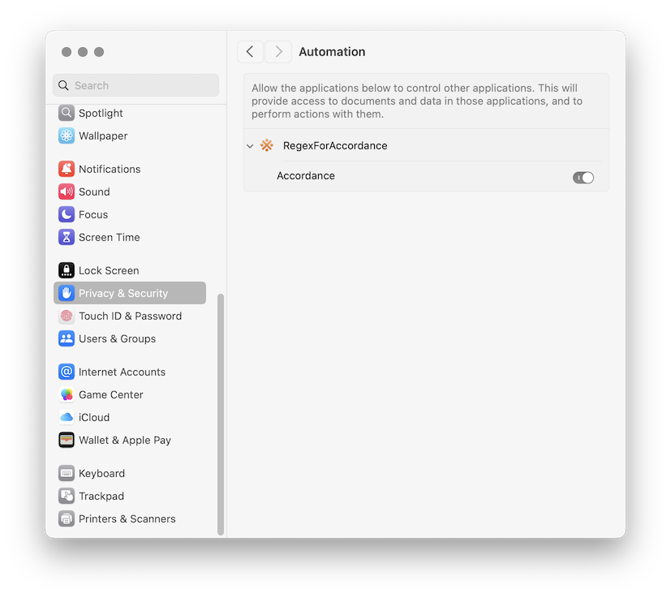

RegexForAccordance
==================

[Accordance](http://accordancebible.com/) for macOS is a Bible study program which hosts original language manuscripts and Bible translations.  Accordance has some very powerful search features, but one thing it lacks is a regular expression search. RegexForAccordance allows you to search any of the text modules in Accordance using regular expressions.

Project Page: http://darinfranklin.github.io/RegexForAccordance/

How It Works
------------

RegexForAccordance gets the text from Accordance through its AppleScript interface.  It transforms the text with some optional filters, and then searches it with the regular expression.  It lists the search results, tabulates statistics, and provides links back to Accordance through the accord:// URL scheme.

The regex matching is provided by Apple’s implementation of [ICU Regular Expression](https://unicode-org.github.io/icu/userguide/strings/regexp.html) syntax.

Because it relies on AppleScript, RegexForAccordance only works with the macOS version of Accordance.  It is not supported on Windows, Android, or iOS.

Installation
------------

Drag RegexForAccordance.app to the Applications folder.

In recent years, Apple has added some restrictions which require additional setup.  Since the app is not signed with a developer certificate, you must grant permission for it to run.  Also, you must grant permission for it to send AppleScript events to Accordance.

### Grant Permission to Run

**Error: Not Opened**

You may get an error saying that RegexForAccordance.app can't be opened.  

Click Done or Cancel.

To fix it, run this command in Terminal.

```
xattr -rd com.apple.quarantine /Applications/RegexForAccordance.app
```

Alternatively, you can handle this in System Settings.

Go to System Settings > Privacy & Security.

Scroll down and look for a message that says "RegexForAccordance.app was blocked…"  

Click **Open Anyway**.




### Grant Permission for AppleScript

**Error: Not authorized to send Apple events**

You may get another error which says, "Not authorized to send Apple events to Accordance."

Go to System Settings > Privacy & Security.

Click Automation > RegexForAccordance.  

Enable Accordance.




Developer Notes
---------------

Use these Accordance preferences when running the unit tests.

- Appearance > Use European verse notation: FALSE
- Appearance > Use SBL standard abbreviations: TRUE
- Citation > Suppress poetry: TRUE

--

Problem: When running from Xcode, you see this error.

>  Unable to communicate with Accordance. Not authorized to send Apple events to Accordance. (Error -1743)

Solution: Product > Clean Build Folder. 

